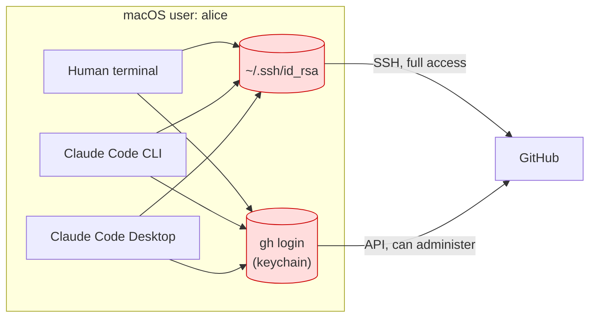
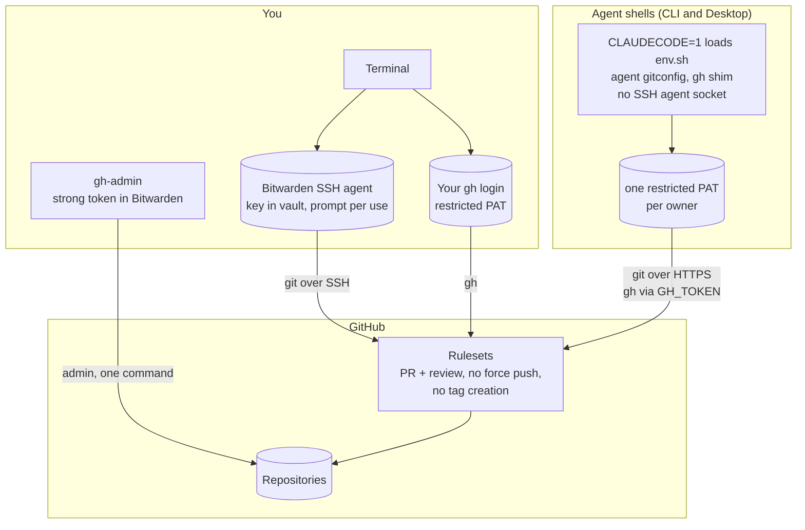
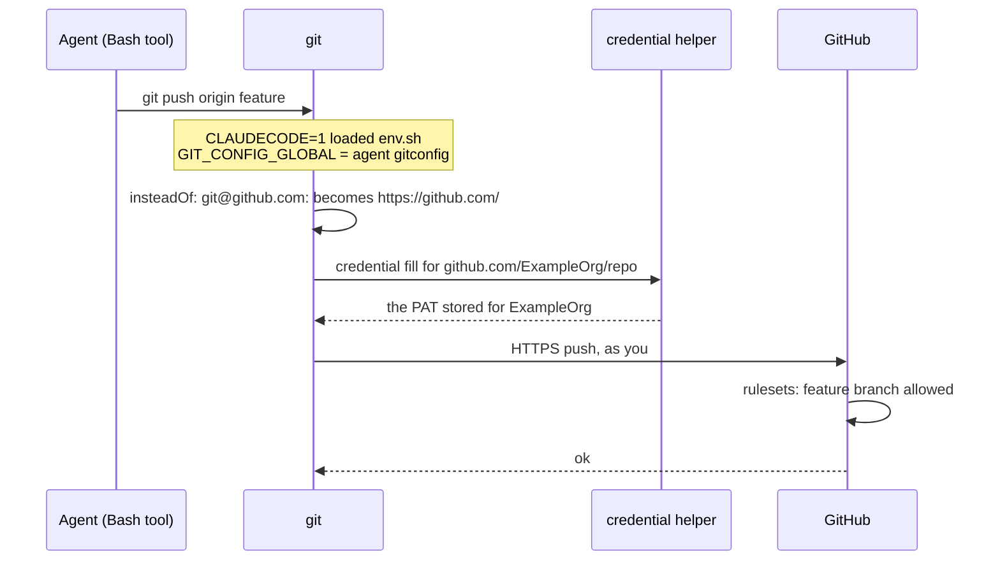

# Agent GitHub access

Let a local coding agent work on GitHub with a token that cannot
administer anything, while your own git and `gh` keep working as
before. Claude Code (CLI and Desktop) on macOS is the worked example.

## Getting started

You need:

- macOS, with zsh as your login shell. bash is supported by the
  installer but not yet confirmed to route; see [step 02](02-agent-routing.md#why-two-startup-files).
- git 2.32 or newer, and the `gh` CLI on your `PATH`.
- `jq` for `check-github.sh` and step 01's MCP check; it ships with
  macOS 15 and later.
- A password manager with an SSH agent, for [step 03](03-ssh-key-to-password-manager.md).
- For each GitHub org you want the agent in: permission to create a
  fine-grained token for it. Some orgs require an owner to approve
  those tokens.

Then:

1. Clone this repo and check out the latest release tag, v0.2.0 or
   later. Read `install.sh` before you run it: it edits your shell
   startup files.
2. Do [step 01](01-github.md) in the browser: restrict your own `gh`
   login and add rulesets on the repos that matter.
3. Run the installer, as [step 02](02-agent-routing.md#run-the-installer)
   describes, with one `--owner` for each owner. At each "Paste the
   agent's PAT for OWNER" prompt, create that owner's token by
   [the recipe](01-github.md#the-token-recipe) and paste it straight
   in. Never save a token yourself; the installer stores it.

   ```zsh
   ./install.sh --owner OWNER --default-owner OWNER
   ```

4. Run step 02's checks in an agent session, then do
   [step 03](03-ssh-key-to-password-manager.md) and
   [step 04](04-claude-code-sandbox.md). Read [step 05](05-living-with-the-sandbox.md)
   when the sandbox gets in the way.
5. Run `./install.sh --check` at any time to see where you stand, and
   `./check-github.sh --repo OWNER/REPO` to check a repo's rules.

The rest of this page explains the model and why it is built this way.

## Upgrading from v0.1.0 (GitHub App)

v0.1.0 gave the agent a GitHub App. This version uses your own
restricted PATs instead. To move over:

1. Do [step 01](01-github.md), then rerun the installer with the full
   command from [step 02](02-agent-routing.md#run-the-installer):
   `--owner` for each owner, and `--default-owner`. It replaces the old
   source line.
2. Delete the App's key and helper, if present:

   ```zsh
   rm -f ~/.config/agent-git/app.pem ~/.config/agent-git/bin/git-credential-github-app ~/go/bin/git-credential-github-app
   ```

3. Uninstall the App from each org and account, then delete it.
4. Once its open PRs are merged, unassign its CodeRabbit seat.
5. If you finished step 03 under v0.1.0, run its new macOS agent
   check in [Remove the file](03-ssh-key-to-password-manager.md#remove-the-file).
6. bash users: if v0.1.0 created a `~/.bash_profile` that holds only
   the source line, add this line at its top, or `~/.profile` stops
   loading:

   ```bash
   [ -r "$HOME/.profile" ] && . "$HOME/.profile"
   ```

## The problem

One macOS user, two actors. The agent runs as that user, so by default
it can use every credential the human has: the `~/.ssh/id_rsa` file for
git over SSH, and the `gh` login for the GitHub API. A browser `gh`
login can create and delete repos, change settings and manage secrets.
Anything that login can do, the agent can do.



Goal: the agent keeps nearly all normal engineering capability, such as
cloning, pushing branches, opening and reviewing PRs, and reading CI.
It cannot create or delete repos, change settings or rulesets, or manage
secrets and collaborators. **GitHub itself refuses those calls,**
because no credential the agent can reach is allowed to make them.

## The model



| | You | The agent |
|---|---|---|
| GitHub identity | you | you |
| git | SSH, key served by your password manager | HTTPS with the owner's restricted PAT |
| `gh` | your own login, a restricted PAT | the owner's restricted PAT |
| Admin | browser, or [`gh-admin`](elevated-gh-access.md) | none: no token it can reach allows it |
| Your SSH key | yes, with a prompt per use | no: no key file, no agent socket |

## Why this model

### Security

- **GitHub enforces the limit.** Every token the agent can reach is a
  fine-grained PAT with Administration, Workflows and Secrets set to No
  access. An admin call fails with 403 whatever happens on your machine.
- **Nothing stronger is lying around.** Your own `gh` login is
  restricted too, step 01 has you remove other GitHub credentials, and
  your SSH key lives in your password manager instead of a file. If the agent steps around its routing, it finds
  nothing more powerful.
- **Admin work needs you.** The strong token sits in Bitwarden behind
  your master password and comes out for one command at a time.
- **Protected refs regardless.** Rulesets on default branches and
  release tags hold whatever credential pushes.

### Operational

- **One identity.** The agent works as you, so CodeRabbit and similar
  tools bill one seat, nothing needs installing per org, and the agent's
  PRs are yours: GitHub will not let you approve them yourself.
- **Your workflow barely changes.** Same remotes. Your `gh` login
  becomes a restricted PAT for one owner. Your SSH key moves to your
  password manager, which prompts for each use.
- **The agent's workflow is unchanged.** `git push`, `gh pr create`,
  `gh pr view` and PR comments all work.
- **One mechanism for CLI and Desktop,** and one token per owner.

### What it accepts

- **The agent's actions look like yours.** Pushes, PRs, comments and
  reviews all show your name. Teammates cannot tell what your agent did.
- **Its approvals would count as yours.** The `gh` shim refuses to
  approve PRs, but that is a local speed bump. An agent that bypassed it
  could approve a teammate's PR as you.
- **Tokens are long-lived and readable by the agent.** Each PAT lasts up
  to a year and sits in a file the agent must read to use it. A leaked
  token reaches one owner's selected repos, without admin, until you
  revoke it or it expires.

## How an agent push works



`gh` follows the same path: a shim asks git's credential chain for the
current repo owner's token and exports it as `GH_TOKEN`.

## The steps

| # | Step | What it does | Required | Time |
|---|---|---|---|---|
| 01 | [01-github.md](01-github.md) | Restricts your own `gh` login, creates the agent's PAT per owner, adds rulesets | yes | 20 min + 10 min per repo |
| 02 | [02-agent-routing.md](02-agent-routing.md) | Runs [`install.sh`](install.sh): stores the tokens, writes the agent gitconfig, env file and `gh` shim, verifies each token | yes | 10 min |
| 03 | [03-ssh-key-to-password-manager.md](03-ssh-key-to-password-manager.md) | Imports your SSH key into Bitwarden, enables its SSH agent, deletes the key file | recommended | 30 min |
| 04 | [04-claude-code-sandbox.md](04-claude-code-sandbox.md) | Turns on Claude Code's sandbox with reads of `~/.ssh` and agent sockets denied | recommended | 10 min |
| 05 | [05-living-with-the-sandbox.md](05-living-with-the-sandbox.md) | Fixes for common sandbox blocks, and a loop that logs them for review | recommended | 15 min reading |

Finish and check [01](01-github.md) and [02](02-agent-routing.md)
before [03](03-ssh-key-to-password-manager.md) and
[04](04-claude-code-sandbox.md), so the agent has working HTTPS access
before the SSH key moves. Each step ends with its own checks and its
rollback. Roll back in reverse step order.

## Other agents (Codex CLI and Desktop, others)

Not done here. These are notes for whoever extends this.

Agent-agnostic, reusable as is: the tokens and rulesets (01), the
gitconfig, credential helper, HTTPS rewrite and `gh` shim (02), and the
password-manager SSH agent (03). They only need the agent's shell to
load the env file.

Agent-specific, needs investigation per agent:

| Concern | Claude Code (this guide) | To check for Codex and others |
|---|---|---|
| How the shell knows it is an agent shell | `CLAUDECODE=1` set by CLI and Desktop; the source lines test it | Which env var, if any, the other agent sets, and whether its shell reads `~/.zshenv` and `~/.zprofile`. If none, add a second marker to the source lines, or launch the agent through a wrapper that sets one |
| OS-level file read denial | `sandbox.filesystem.denyRead` in `~/.claude/settings.json`, Seatbelt | Codex CLI has its own Seatbelt sandbox (`~/.codex/config.toml`, `sandbox_mode`). Check whether it can deny reads of `~/.ssh`, not only confine writes, and whether the desktop app honours it |
| Tool-level read denial | `permissions.deny` `Read(~/.ssh/**)` | The equivalent in the other agent's config, if one exists |
| Network allowlist and unix sockets | `sandbox.network` | Codex defaults to network off inside its sandbox. Check that git and `gh` can still reach `github.com` |

Rule of thumb: keep steps [01](01-github.md) to [03](03-ssh-key-to-password-manager.md) shared across agents. Give each agent
its own version of [step 04](04-claude-code-sandbox.md) and its own marker in the [source line](02-agent-routing.md#why-two-startup-files).

## On Linux

Not walked through. The table maps each macOS mechanism to its Linux
counterpart.

| Concern | macOS (this guide) | Linux |
|---|---|---|
| Agent surfaces | Claude Code CLI and Desktop | CLI only; Claude Desktop does not ship for Linux |
| Installer and shell | `install.sh` supports zsh and bash login shells | The installer and the `gh` shim are bash 3.2 and the env file is POSIX, so both shells work. The installer refuses Linux for now: it uses macOS-only tools (`stat -f`, `date -j`, `plutil`) |
| Sandbox | Seatbelt, built in | bubblewrap + socat; install them first. Same settings keys |
| Password-manager agent | Bitwarden or 1Password sockets as in [03](03-ssh-key-to-password-manager.md) | Socket paths differ by package (deb, snap, flatpak); check the vendor docs. 1Password: `~/.1password/agent.sock`. No Secretive; gnome-keyring or KeePassXC agents also work |
| Key backup | the Bitwarden vault item, plus an optional encrypted vault export | same |
| Clipboard | `pbcopy` | `wl-copy` or `xclip` |
| Keychain | login keychain via `security` | Secret Service (libsecret); the `helper =` reset already clears it for git |
| Home | `/Users/alice` | `/home/alice` |
| Stronger isolation | a separate macOS user is awkward | a separate Linux user or rootless container is cheap |

## Paths

- `OWNER` means a GitHub org or user that owns repos (`ExampleOrg`,
  `alice`).
- Agent-only files live under `~/.config/agent-git/` and
  `~/.config/agent-gh/`, including one token file per owner. The
  installer writes them; [step 02](02-agent-routing.md#what-it-writes)
  lists each one. Outside those directories it adds one source line to
  two startup files, with a first backup of each, kept across reruns.
  For bash users with only `~/.profile`, it also adds a line that
  sources `~/.profile` to the new `~/.bash_profile`. It touches nothing
  else of yours.
- [Elevated `gh` access](elevated-gh-access.md) is optional: `gh-admin`
  runs one admin command with a token kept in Bitwarden.
- [`files/`](files/) holds the `gh` shim, the credential helper, `ssh-who`,
  `gh-admin`, and the Claude Code settings fragment for
  [step 04](04-claude-code-sandbox.md#settings). It also holds `git-pat`,
  a git wrapper for editors from
  [step 03](03-ssh-key-to-password-manager.md#when-a-prompt-appears-that-you-did-not-expect),
  and, for [step 05](05-living-with-the-sandbox.md#the-friction-loop),
  `claude-md-agent-rules.md` and `skills/sandbox-triage`.
- Commands work in zsh and bash. No `sudo`.
